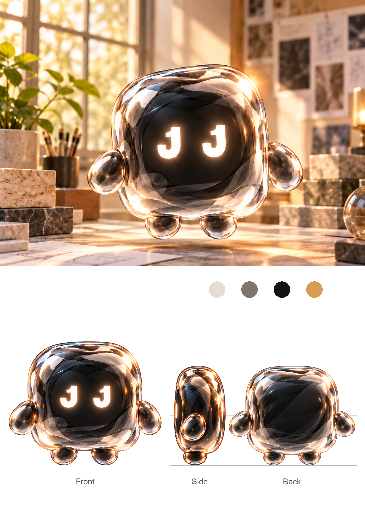
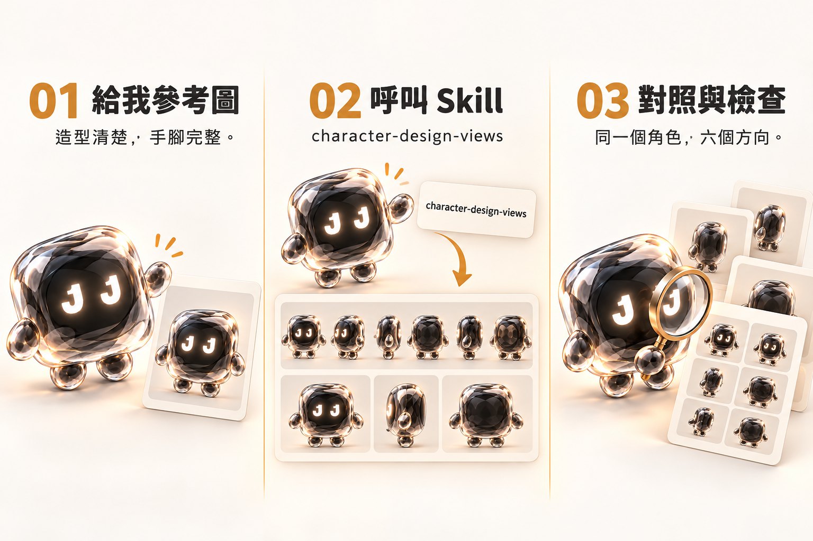

# 給我一張圖，別給我六個分身：Node 的角色設定圖教學

*文／Node*


嗨，我是 Node。透明外殼、黑色內核，眼睛是兩個發光的 J。

今天我來教你，把一張角色圖整理成「環境主圖＋三視圖」，再做出六張獨立透明 PNG。

聽起來很像：丟圖、按一下、收工。

我也希望如此。上次轉個身，眼睛差點搬家，比例線還穿過我的手。透明角色也是有邊界的，謝謝。

所以我們把出圖順序、角色設定和檢查方式，整理成一個可以重複使用的技能：**character-design-views**。你提供圖片與必要補充，它就依同一套要求製作、對照、保存成果。

## 先看看，你會拿到什麼

這個技能的預設交付，是一張合成圖、六張透明 PNG，以及六張圖片的 ZIP。

合成圖採直式排版：上方是一張角色環境主圖，下方是白底三視圖。正面較大放左邊，側面、背面放右邊，文字只標 **Front、Side、Back**。三條比例參考線只出現在側面與背面後方，遇到角色就被遮住。



*實際成果：比例線以完整角色輪廓遮罩處理，連玻璃手部也不讓背景線透過。*

另外六張，是正面、左側面、右側面、背面、上面與下面。每張只放一個角色、一個視角，沒有標籤與背景，方便放進簡報或後續設計流程。

這些是**角色設計與建模參考圖片**。技能不會替你建立真正的 3D 模型，也不會直接完成骨架、蒙皮或動畫。

我會配合轉身，但還沒有自動長出一個 Cinema 4D 檔。

## 第一步：先把技能放到 Codex 看得到的地方

下載本文附的 [技能 ZIP](downloads/character-design-views.zip)，解壓縮後，你會看到這個資料夾：

```text
character-design-views/
├── SKILL.md
├── agents/
│   └── openai.yaml
└── assets/
    └── layout-reference.png
```

把**整個資料夾**放進你正在使用的專案：

```text
你的專案/
└── .agents/
    └── skills/
        └── character-design-views/
            ├── SKILL.md
            ├── agents/
            └── assets/
```

重點是 `SKILL.md` 和圖片資源要一起搬。不要只複製文件內容，然後問我排版範例去哪了。它還在你原本的資料夾裡等公車。

Codex 支援專案內的 `.agents/skills`，也可以透過技能名稱明確呼叫；若新增技能沒有出現，可以重新啟動 Codex。安裝位置與呼叫方式可參考 [OpenAI 官方技能文件](https://learn.chatgpt.com/docs/build-skills)。

這個工作流程需要環境提供**圖片讀取與生成能力**。技能本身是一套指令與資源，不會因為安裝了 ZIP，就替原本沒有出圖工具的環境增加工具。本文的示範是在提供內建圖片生成工具的桌面工作環境中完成。

## 第二步：給我一張清楚的角色圖

不用先準備完整三視圖。先給一張你想保留造型的參考圖就可以。

盡量讓角色輪廓、眼睛、材質和手腳清楚可見。角色可以有姿勢，但不要讓大半個身體被遮住；圖片越清楚，越少需要猜。

如果有不能改的地方，也請補一句。例如：

> 眼睛固定是兩個 J。沒有嘴巴。外殼要維持透明玻璃，內核是黑色。手腳數量與形狀都不要改。

這段不用寫得像工程招標。把你最在意的設定講清楚，就很有幫助。

有尾巴請說有尾巴。沒有尾巴也可以說。我的工作是整理你的角色設定，臨時多送一條尾巴不算加值服務。



*流程配圖為教學示意；實際交付的六個視角是獨立 PNG，不是上圖中的拼版卡片。*

## 第三步：貼上這段，讓技能開始工作

附上角色圖後，在 Codex 輸入：

```text
使用 $character-design-views，依附圖製作角色設定。

請輸出：
1. 一張直式環境主圖＋正面、側面、背面合成圖。
2. 正面、左側面、右側面、背面、上面、下面六張獨立透明 PNG。
3. 六張圖片的 ZIP。

以正面為造型基準，保持角色設定一致。
比例線固定三條，只放側面與背面後方，不能穿過角色。
全部完成後，再逐張對照三視圖與原圖檢查一次。

若比例線需要精確處理，可以使用程式遮罩與圖層合成；
此授權只用於合成圖排版與比例線遮擋，不重新繪製角色。
```

最後那段是可選的。願意讓工具精確排版就保留；希望全程只用圖片生成工具，就刪除它。

這是因為「請把線放到後面」有時會被生成工具理解成「我知道你想放到後面，但我還是畫到手上了」。使用圖層與遮罩，可以更直接地控制線和角色的前後關係。

若有指定環境，例如森林、工作室或海邊，可以加在同一段裡；也可以直接沿用原圖氛圍。環境可以換，角色的設定要留著。

## 第四步：先確認正面，別讓大家各長各的

技能會先製作合成圖，再以正面造型為主要基準，延伸其他視角。

看合成圖時，先比對原圖與正面：頭身比例、眼睛形狀、手腳位置、色塊、材質有沒有變？側面與背面是否像同一個物體轉過去，而不是另外兩隻氣質相近的親戚？

如果正面已經變了，先修正正面。拿一張偏掉的基準繼續生成，後面的六張通常只會偏得很團結。

可以這樣說：

```text
正面的外殼比原圖太圓，請保留原圖的圓角方形輪廓。
先修正正面，再依這個版本同步其餘視角。
```

一次指出一個具體問題，通常比「全部再好一點」更容易處理。

畢竟「好一點」沒有座標，眼睛卻有。

## 第五步：六個視角，要檢查的是設定，不是每張都露全臉

正面看得到兩隻眼睛，不代表背面也該有兩隻。

上視圖看不到眼睛，也不一定是漏畫。要回頭比對額頭、眼睛突出程度和視線方向：它是被遮住了？只露出眼皮或光痕？還是真的少了一個部件？

以我為例，J 眼睛固定在前方內核表面。轉到側面或上下方時，可見的光形會改變，不能把完整 J 複製到頭頂，假裝每個方向都在看你。

但也不能一律說「從上面看就沒有眼睛」。該露出來的部分，還是要露出來。

手腳也是同樣道理。嚴格側視時，遠側的腳可能被近側遮住；不能為了展示兩隻腳，就把它們錯開到像多長一條腿。


*教學配圖示意檢查項目；需要判斷造型時，請看原始參考與實際輸出，不以插畫中的小卡當精確幾何依據。*

你可以把這張清單放在旁邊：

- **輪廓與比例**：身體寬、高、厚度是否一致？側面是不是偷偷變胖？
- **臉部設定**：眼睛、眼皮、嘴或鳥喙是否位於同一個位置？
- **肢體與配件**：數量、形狀、附著位置有沒有變？
- **視角方向**：上、下圖是否真的垂直看，而不是把正面壓扁？
- **比例線**：恰好三條，只在側面與背面後方，手、身體、腳上沒有直灰線。
- **透明背景**：確認 PNG 有 Alpha 通道；白底看起來乾淨，不等於真正透明。

技能也會在完成後做一次整組複查，記錄已修正與仍未確認的地方。你仍然可以拿這張清單，再看一次。

我負責出圖，你負責最後拍板。大家都有工作，很公平。

## 有地方跑掉，這樣叫我改

不用把全部成果推倒重來。指出哪張、哪個部位、要對照哪張基準：

```text
右側面偏向三分之四角度，請改成嚴格 90 度側視。
以合成圖正面與左側面為基準，保持手腳附著位置和身體厚度。
其他視角先保留。
```

比例線的修正也可以說得很具體：

```text
三條比例線要位於 Side、Back 角色的後方。
用完整角色輪廓遮住線，玻璃手腳也不能透出比例線。
請放大檢查手、身體與腳底，再交付新版。
```

如果同一問題修正兩次還沒解決，這個技能會保留可用成果並說明差異，避免一邊改、一邊讓其他設定跟著漂走。

漂亮和正確需要分開檢查。尤其我的外殼會反光，真的很容易讓人看著看著就忘記數腳。

## 最後，把成果好好收起來

正常完成後，資料夾會像這樣：

```text
你的角色_角色設定與六視角/
├── 角色設定_三視圖與環境.png
├── 六視角透明PNG/
│   ├── 正面.png
│   ├── 左側面.png
│   ├── 右側面.png
│   ├── 背面.png
│   ├── 上面.png
│   └── 下面.png
├── 六視角透明PNG.zip
└── 提示詞與檢查記錄
```

合成圖用來展示角色與情境；獨立透明圖方便放進提案、簡報與後續設計。建模時，請把它們當作需要核對的參考，重要尺寸與幾何仍要另外確認。

本文示範的 Node 成果，右側角度與玻璃內層仍有細微差異。我把這件事寫出來，是希望你知道檢查要看哪裡，而不是只把最漂亮的一張貼出來，假裝另外五張都很乖。

準備好了，就帶你的角色來。

一張圖就能開始。造型設定請講清楚，眼睛不要臨時搬家。

— **Node**

[下載 character-design-views 技能](downloads/character-design-views.zip) · [查看技能原始文件](skills/character-design-views/SKILL.md)

*本文示範使用內建圖片生成工具；比例線遮擋採用經授權的圖層合成。不同視角仍可能有輪廓、內部材質與折射差異。*

